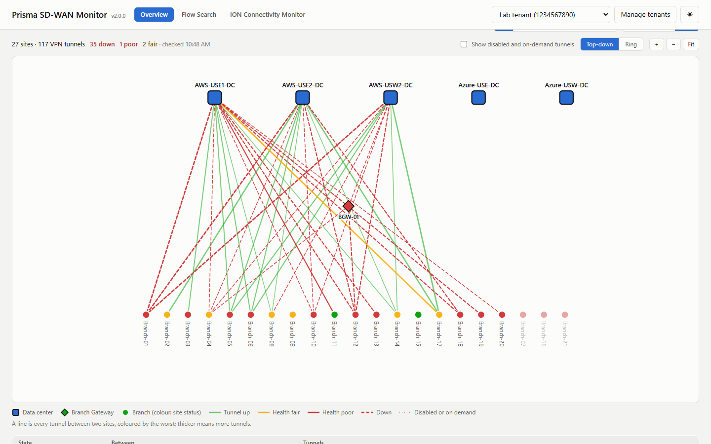
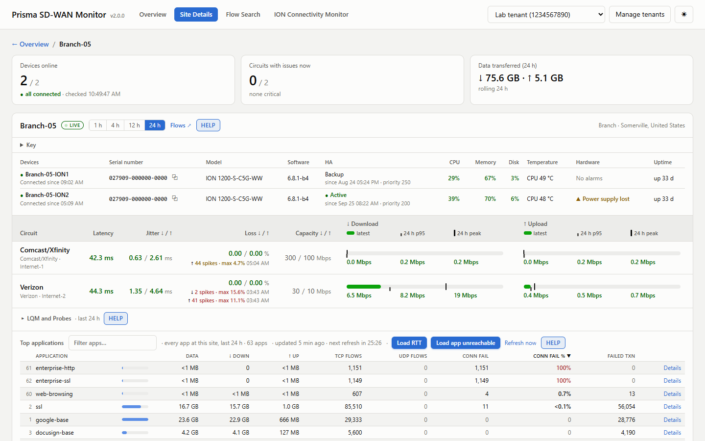
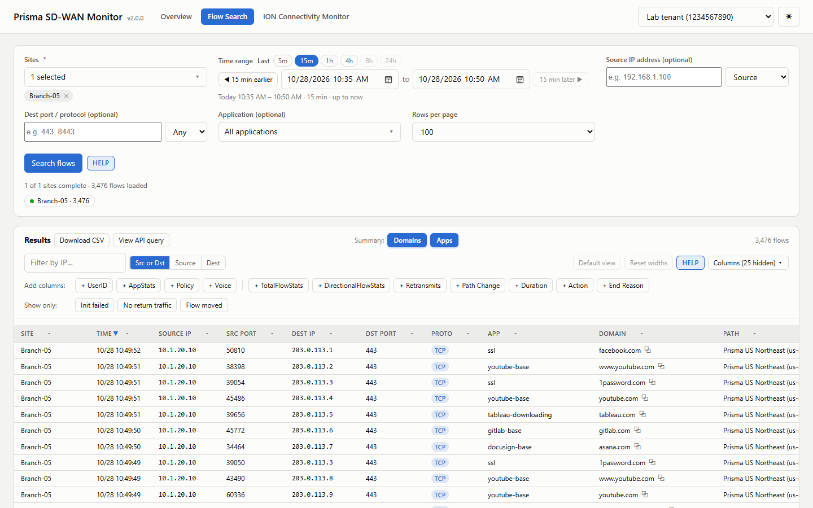
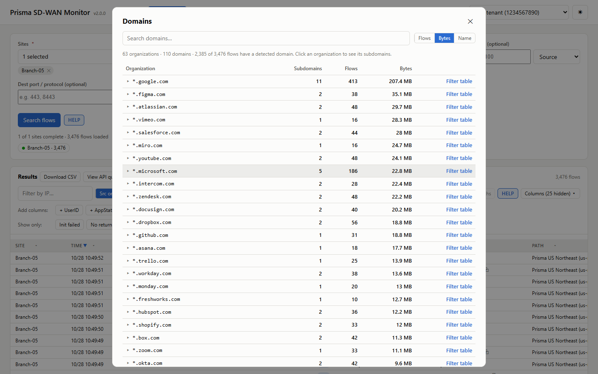
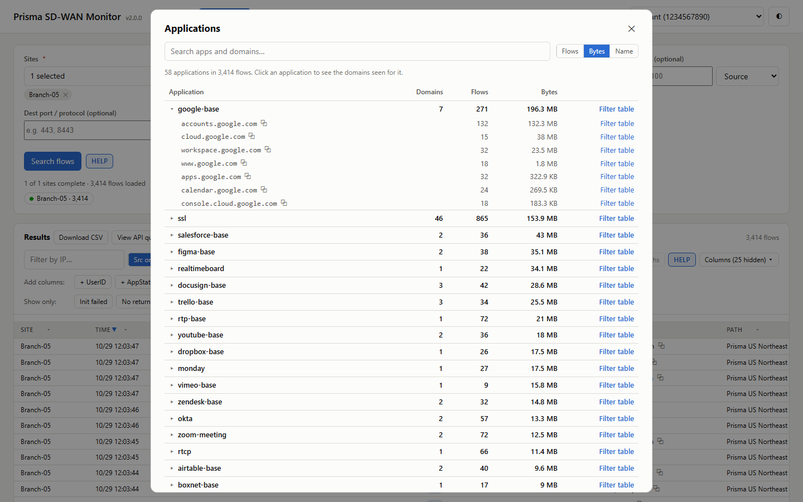
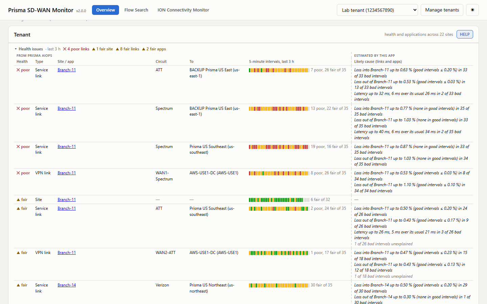
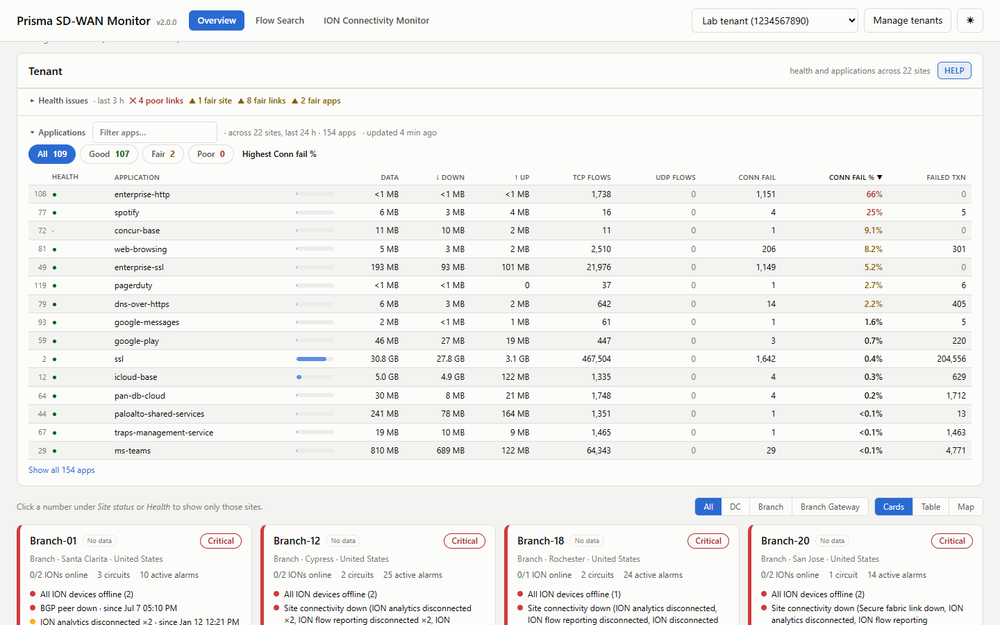

# Prisma SD-WAN Monitor

A dashboard for your Prisma SD-WAN tenants that runs on your own computer: site status, circuit health, devices, top
applications, alarms, an ION connectivity monitor and flow search. Switch between several tenants.

Not an official Palo Alto Networks product; provided as-is under the [MIT licence](LICENSE).

## Screenshots

**Overview, Map view:** the sites and the VPN tunnels between them, coloured by state and health.

**Site details:** devices, circuits (latency, jitter, loss, p95 and peak use), LQM and probes, and top applications
with data, flows, failed connections, failed transactions (request / response exchanges that didn't complete, inside
connections that did open), app unreachable (no TCP ACK for 60 seconds in a row) and RTT (the network round trip to the
app's servers: p95 over the period with its trend, and the average over the last 5 minutes).

**Flow Search:** flow records for one or more sites: time, source and destination IP and port, protocol, user, app,
domain, direction, path, path changes and Flow Move, path / QoS / security policy, RTT, server and UDP response times,
bytes and packets (each direction and total), duration, TCP retransmits, voice jitter / loss / MOS, action and drop
reason, end reason, connection setup, return traffic and security action.

**Flow Search, Domains summary:** the domains seen in the results, grouped by organization.

**Flow Search, Apps summary:** the applications seen in the results, with the domains seen for each.

**Overview, Health issues:** the fair and poor sites, links and apps from Prisma AIOps, with the likely cause.

**Overview, Applications:** the applications across all sites, sorted by the highest connection failure percentage.

## Flow Search fields

**Search** (sent to the API, so fewer flows are fetched): sites, time range, IP address (source, destination or
either), destination ports, protocol (TCP, UDP, ICMP) and applications. Searches over 4 hours need an application or IP
address filter.

**Results table:** every column can be searched and filtered: click its ▾, type in **Search values…** to find values,
then pick the ones to show (**Select matches** picks everything the search found). Every column except Security sorts
when you click its header. There is also a **Filter by IP** box (source, destination or either) and **Show only**
buttons: *Init failed*, *No return traffic* and *Flow moved*.

The columns, by their **Add columns** button:

| Button | Columns |
| --- | --- |
| *(shown by default)* | Site, Time, Source IP, Src Port, Dest IP, Dst Port, Proto, App, Domain, Path, Init OK, Return, Security |
| UserID | User |
| AppStats | Avg RTT, Avg SRT, Avg UDP TRT |
| Policy | Path Policy, QoS Policy, Security Policy |
| Voice | Jitter, Loss, MOS |
| TotalFlowStats | Total Bytes, Total Packets |
| DirectionalFlowStats | Bytes C2S, Bytes S2C, Packets C2S, Packets S2C |
| Retransmits | Retx Pkts, Retx %, Retx Bytes |
| Path Change | Path Change, Assurance |
| Duration | *(same name)* |
| Action | *(same name)* |
| End Reason | *(same name)* |
| *(Columns menu only)* | Direction |

- **Path Change:** why the flow moved to another WAN path mid-way, e.g. an SLA breach, the path going down, or
  asymmetry (`asymmetry_path_change`, `probe_bad_path_change`). Blank: it stayed on one path. Underneath, *from …* is the
  path it was on before, when the search goes back far enough; hover for every path with times.
- **Assurance:** *Flow Move* when a performance policy rule with the *Move Flows* action put the flow on its path, e.g.
  because another path broke the rule's SLA (same as SCM's *Assurance: Flow Move*). Underneath, *from …* is the path it
  was kept off and why: *app RTT*, *app unreachable*, or a probe (e.g. *probe: high RTT*).
- **Action:** what the ION did with the flow: forwarded, or `flow_drop`. Dropped flows show why underneath: a firewall
  TCP state violation (the first packet seen wasn't a SYN), a security policy deny (with the rule), no security zone on
  the source interface, no allowed path up, or no path allowed by the path policy. Hover for details.
- **End Reason:** how the session ended: `tcp-fin` (normal close), `tcp-rst-from-client` / `tcp-rst-from-server`
  (reset), `aged-out` (idle timeout). *n/a*: not reported (ION software before 6.8).
- **Init OK:** the record's `init_success` field: whether the ION saw the TCP 3-way handshake complete. **Yes**: it
  completed. **No**: it did not (no answer, a refusal, or a half-finished handshake). **-**: not reported, i.e. it
  doesn't apply (UDP, ICMP).
- **Return:** what came back from the server, worked out from the record's packet counts and TCP flags, checked in this
  order:
  1. **Dropped**: Action is `flow_drop` (the ION dropped the flow itself; Action says why).
  2. **-**: no packets in either direction.
  3. **No**: the client sent packets but the server sent none (forwarded, but nothing came back).
  4. **Reset**: every server packet was a TCP reset (nothing listening on that port, or a host firewall rejected it).
  5. **SYN-ACK only**: Init OK is No and every server packet was a SYN-ACK (the server accepted, but the client never
     sent the final ACK, or its ACK took a path the ION didn't see).
  6. **Yes**: anything else; the server sent data back.

  Read together when Init OK is No: Return = **No** means nothing answered, so look at the network path (routing, a
  firewall or policy drop, the host down). **Reset** or **SYN-ACK only** means the server is reachable but refused or
  the handshake stalled, so look at the service or port.
- **Security:** the security policy action(s) applied to the flow, e.g. `allow`, `deny`, `deny_unknown_source_zone`.
  Taken from the actions of the security rules on the record (`security_policy_rules`), or, when there are none, from
  `sec_policy_actions`; several different actions are listed comma-separated, and **-** means none were reported. The
  rule name itself is in the Security Policy column.

## Start

You need Python 3.10 or newer. Open a terminal in the Monitor's folder and run:

- **Windows:** `.\start.bat`
- **macOS / Linux:** `./start.command`

The first start takes about a minute. The Monitor then opens at http://127.0.0.1:5050.
To stop it, press Ctrl+C in the terminal.

What the start script does on your computer, all inside the Monitor's folder:

1. Checks for Python 3.10 or newer.
2. On the first run, creates a private Python environment in `.venv`. Nothing is installed system-wide.
3. Installs the packages in `requirements.txt` into `.venv` (Flask, Waitress, Requests, and Keyring on macOS / Linux),
   downloaded from PyPI. It does this again only when `requirements.txt` changes, for example after a `git pull`.
4. Runs `app.py`, which serves the Monitor on 127.0.0.1:5050 (only reachable from this computer) and opens it in
   your browser.

To remove the Monitor, delete your tenants in **Manage tenants** (on macOS / Linux that also removes their secrets from
the keychain), then delete its folder.

## Add a tenant

Click **Manage tenants**, enter the TSG ID, a name, and the client ID and secret of a service account (read-only is
enough), click **Test**, then **Save**.

## Where things are kept

Everything stays in the `data` folder next to `app.py`: your tenants, and caches that make pages open fast after a
restart. Client secrets are kept in the OS keychain (macOS Keychain), or encrypted for your Windows account. Nothing is
sent anywhere except to Palo Alto Networks.

To use another port or data folder, set `PORT` or `MANAGER_DATA_DIR` before starting.

**Upgrading from 1.x:** stop 1.x, update the folder (`git pull`, or unzip over it), start again. Your tenants and
secrets carry over.

## How it works

The Monitor has two parts, both on your computer.

**The server** (Python: Flask, served by Waitress on 127.0.0.1) does all the work with Prisma SASE:

- Keeps your tenants and their secrets, gets an OAuth2 token per tenant, and is the only part that talks to the API.
  Your browser never sees a client secret or token.
- Paces every API call (a rate limit, a cap on calls in flight per endpoint, slowing down after a 429, retries), and
  shares and caches results, so several tabs don't multiply the calls.
- Turns API responses into what each page shows: site status, problems and alarms, circuit statistics (p95, peaks,
  spikes), device health, app statistics, probe results, health, and flow records with policy and app names.
- Runs background jobs: refreshing the Overview, the 24 h of 1-minute circuit data for open sites, Top applications,
  Flow Search, and the ION Connectivity Monitor, which watches the IONs even when no page is looking.
- Saves what is slow to fetch again in the `data` folder, so pages open fast after a restart.
- Blocks requests that don't come from its own pages (Host and cross-site checks, a strict Content-Security-Policy).

**The client** (your browser: two pages built with Alpine.js, the Dashboard and Flow Search) shows the data:

- Asks the server for JSON and polls it while a page is open (the Overview, the open site, a running search). It
  never calls Prisma itself.
- Draws the pages: the Overview's cards and table, Site details' tables and bars, filters, sorting, paging, the
  period choice, HELP, and the light / dark theme.
- Works out what is only about display: cell colours and statuses from the server's figures, Flow Search's column
  filters, sorting and summaries, and CSV export.
- Keeps your view settings (sort, filters, collapsed sections, acknowledged app alarms) in the browser.
- Shows the ION Connectivity Monitor's alerts, pop-ups and sound as soon as the server reports an event.

## More

- Each section has a **HELP** button that explains where its data comes from.
